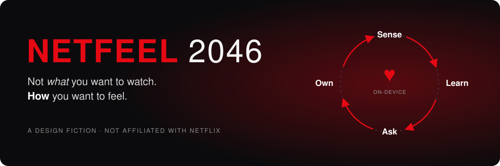
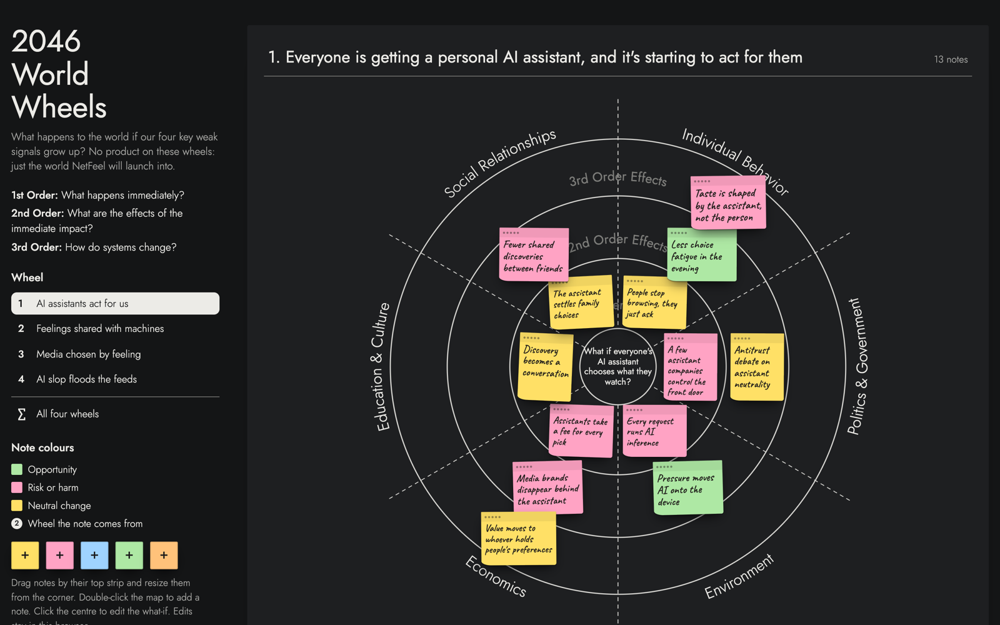
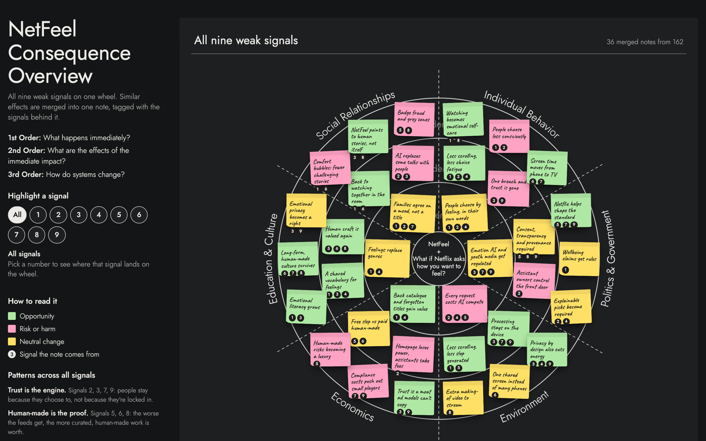
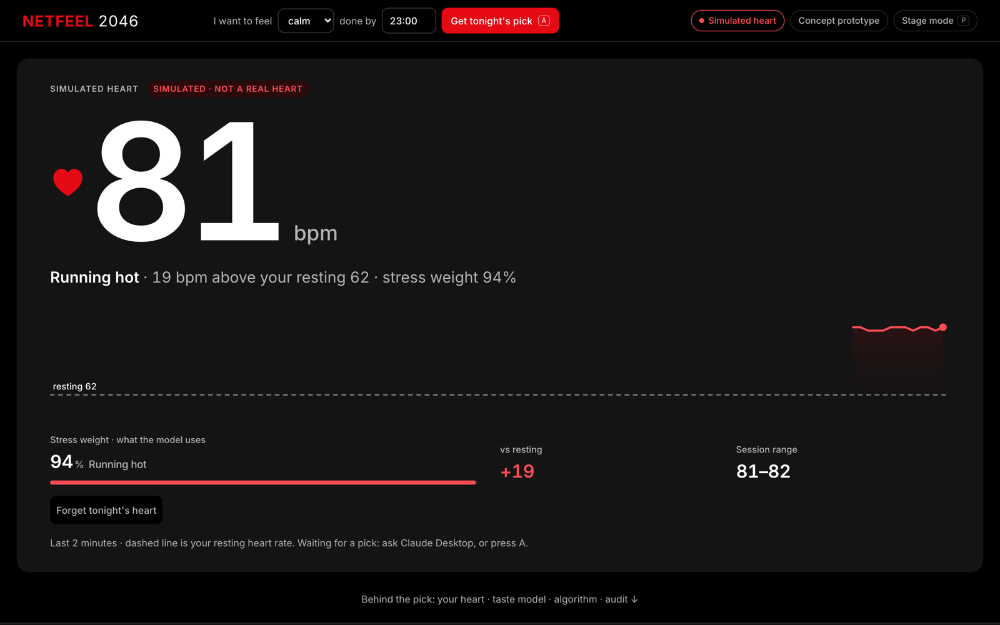
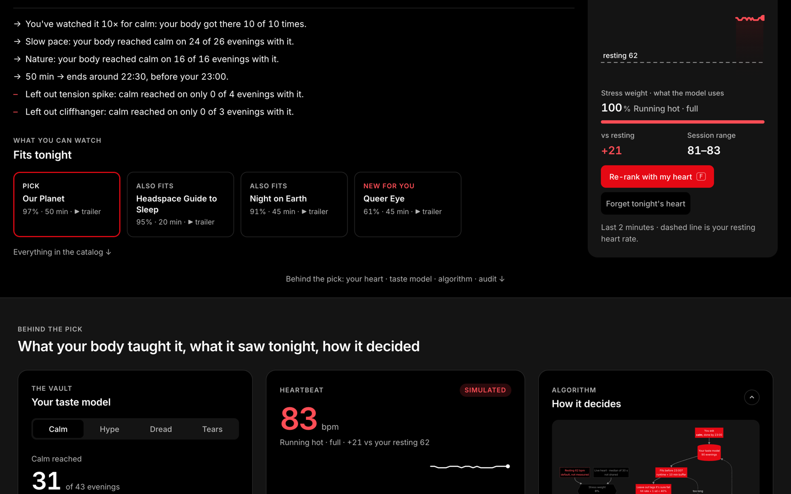
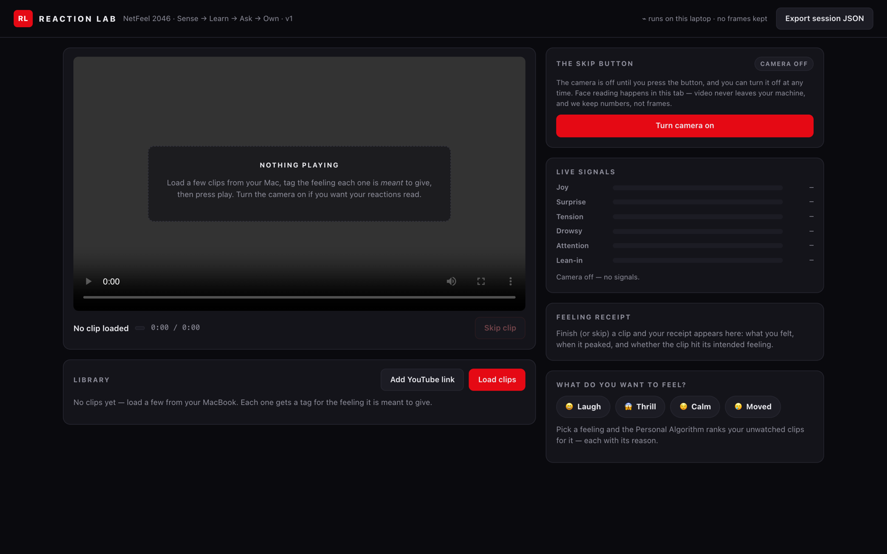

<p align="center">
  
</p>

<p align="center">
  <a href="LICENSE"></a>
  <a href="LICENSE-DOCS.md"></a>
  
  
  
</p>

<p align="center">
  <b>A collection of weak signals and working prototypes about one question:</b><br>
  <i>what if Netflix didn't ask what you want to watch, but how you want to feel?</i>
</p>

<p align="center">
  <a href="#-the-weak-signals">Weak signals</a> ·
  <a href="#-where-they-lead">Consequences</a> ·
  <a href="#-the-prototypes">Prototypes</a> ·
  <a href="#-the-idea-they-add-up-to">The idea</a> ·
  <a href="#-run-it-yourself">Run it</a> ·
  <a href="#-whats-inside">What's inside</a>
</p>

> [!IMPORTANT]
> **This is a design fiction.** NetFeel is a speculative concept study, created for the Design Future Course around the brief *imagine Netflix in 2046*. It is **not affiliated with, endorsed by, or produced by Netflix**. The signals are built on real, sourced evidence; everything set after today is projection, written in the same citation style on purpose. Unverified claims are flagged where they appear.

---

## 📡 The weak signals

A weak signal is something small you can already see today that hints at a bigger change. We scanned widely, ranked 21 signals by how much weight they carry, and kept **nine**. Together they point at one shift: people already pick media for how it makes them *feel*, assistants are starting to choose for them, and trust is becoming the scarce thing.

| # | Signal | What you can see today | Where it points |
|:-:|---|---|---|
| 1 | **Media is used to reach a feeling** | ~63% of ASMR viewers use it to fall asleep; comfort rewatching tops the charts | Netflix sells *states*, not hours |
| 2 | **The assistant becomes (almost) the remote** | ~800M people use ChatGPT weekly; assistants now buy and book for you | "I need to calm down" goes to the assistant, and it asks Netflix |
| 3 | **We trust machines with feelings, but trust beats usage** | 72% of US teens have used an AI companion; only 11% enjoy AI "a lot" | Whoever earns trust wins, not whoever gets the most use |
| 4 | **Mood search has already been tested** | Netflix ran an AI search beta that understands moods | The tech is ready; feeling becomes the search box |
| 5 | **AI slop floods the feeds** | >20% of videos shown to new YouTube users are AI slop | "Verified human-made" becomes worth paying for |
| 6 | **Counter-trend: back to curated, human-made** | 73% of Gen Z discover through social today | The next generation tires of feeds; curation is the moat |
| 7 | **Under-16 social-media bans** | Australia's ban is law, yet 81.5% of kids still use the apps | Bans alone don't build trust; a safe place kids *want* does |
| 8 | **A human-made making-of for every title** | 46% of fans seek creator content around what they watch | Proof-of-human as a feature |
| 9 | **Rules for emotion data** | The EU AI Act treats emotion recognition as high-risk; the DMA makes data portable | Your mood profile is legally becoming yours |

→ Full signals with sources: [`signals/`](signals/) · the 21-signal longlist: [§2 of the paper](paper/netfeel-paper.md#2-trends-and-weak-signals) · the evidence base: [`research/`](research/)

## 🌀 Where they lead

Each signal was pushed forward to 2046 on a consequence wheel: first-, second- and third-order effects across six areas (social relationships, individual behaviour, politics, environment, economics, education & culture).

<table>
  <tr>
    <td width="50%"><a href="signals/netfeel-world-wheels.html"></a></td>
    <td width="50%"><a href="signals/netfeel-consequence-overview.html"></a></td>
  </tr>
  <tr>
    <td><b>2046 World Wheels</b>: the four key signals, one wheel each</td>
    <td><b>Consequence Overview</b>: all nine signals, 162 notes merged into 36</td>
  </tr>
</table>

Four patterns came out of the wheels:

- **Trust is the engine.** People stay because they choose to, not because they're locked in. *(signals 2, 3, 7, 9)*
- **Human-made is the proof.** The worse the feeds get, the more curated, human-made work is worth. *(signals 5, 6, 8)*
- **On the device, by design.** Privacy, regulation and energy all point to local processing. *(signals 3, 7, 9)*
- **The risks sit in economics and social life:** gatekeeping assistants, compliance costs, human-made as a luxury, comfort bubbles.

The wheels are interactive: open them in a browser, highlight a signal, move notes or add your own.

## 🧪 The prototypes

Two working prototypes show that the core of the idea is buildable today, with the privacy stances implemented, not just claimed.

### Taste model + MCP server · *heart sensing*

A taste model the member owns, fed by a live heart rate from a Garmin watch. Any AI assistant that speaks [MCP](https://modelcontextprotocol.io) (like Claude Desktop) can ask it for tonight's pick. Every pick comes with its reasons and an audit entry that says **"paid placement: none"**, hash-chained so silent edits are detectable.

| Before a pick: your live heart | After a pick: the reasons and what's behind them |
|---|---|
|  |  |

- **Consent per read:** the heart is shared only when you say so (share once or skip).
- **Forgetting is real:** "Forget tonight's heart" deletes every raw reading; the audit log still verifies because it never stored them.
- **The model is a file you own:** readable JSON, exportable, deletable.

→ [`prototypes/taste-model-mcp/`](prototypes/taste-model-mcp/) · zero dependencies · 6 self-tests

### Reaction Lab · *face sensing*

Watch a clip while a face model reads your reaction in the browser (MediaPipe, fully on-device). Six signals become a **Feeling Receipt** (what you felt, when it peaked, whether the clip hit its intended feeling), and a personal taste model recommends what to watch next, with a reason for every pick.



- **The Skip Button:** the camera is off until you turn it on.
- **Numbers, not frames:** video never leaves your machine and no frames are kept.

→ [`prototypes/reaction-lab/`](prototypes/reaction-lab/) · deterministic scoring core · 9 unit tests

## 💡 The idea they add up to

Put the signals together and you get **NetFeel**: in 2046, Netflix doesn't ask *what* you want to watch. It asks **how you want to feel**.

| | Step | What happens | Signals behind it |
|:-:|---|---|:-:|
| ♥ | **Sense** | A wearable you already own reads heart rate, HRV, skin temperature and movement while you watch. | 1 |
| ◐ | **Learn** | An on-device model learns which titles produce which feelings *on you*, judged by your body, not your clicks. | 1 |
| ? | **Ask** | You ask for a feeling ("I need a good cry tonight"), or your assistant asks *your* model for you. One pick, and why. | 2, 4, 6 |
| 🔒 | **Own** | Consent per read, deletion that actually deletes, an audit log nobody can quietly edit. Never sold, never used for ads. | 3, 7, 9 |

The success metric changes too: instead of watch-hours, the **State-Hit Rate**, the share of evenings your body confirms the feeling you asked for.

*AI does the sensing; humans do the storytelling.*

The full scenario (one evening in 2046, how Netflix gets there, who wins and who loses, and the guardrails) is in [`paper/netfeel-paper.md`](paper/netfeel-paper.md), or the [2-page version](paper/netfeel-paper-short.md).

## ▶️ Run it yourself

**Reaction Lab** (any modern browser + Python 3 for a static server):

```bash
cd prototypes/reaction-lab
bash scripts/fetch-model.sh     # one-time face model download (Apache-2.0)
python3 -m http.server 8046     # open http://localhost:8046
npm test                        # the scoring algorithm, tested headlessly
```

**Taste model + MCP server** (Node ≥ 18, no `npm install`; Chrome for Web Bluetooth):

```bash
cd prototypes/taste-model-mcp
npm run check                   # self-test: picks, consent, deletion, audit tamper detection, MCP handshake
npm run reset                   # rebuild the simulated member's model
npm start                       # open http://localhost:4046
```

No watch? Press **S** on the page for a simulated heart. To connect Claude Desktop, `npm run check` prints the exact config; the full walkthrough is in [`SETUP.md`](prototypes/taste-model-mcp/SETUP.md).

> The member in the demo, "Daan", and his viewing history are simulated. No real body data ships in this repo.

## 📁 What's inside

```
netfeel/
├── signals/                  the 9 weak signals and the interactive consequence wheels
├── research/                 the evidence base: Netflix, tech horizon, kids & media, attention, sources
├── prototypes/
│   ├── taste-model-mcp/      heart sensing + a member-owned taste model over MCP
│   └── reaction-lab/         face sensing, on-device, in the browser
├── paper/                    the 2046 scenario that ties it together (full + 2-page)
└── docs/                     the earlier "Feeling Line" concept, and the images
```

| Folder | Start with |
|---|---|
| [`signals/`](signals/) | [`final-signals.md`](signals/final-signals.md) for the nine signals, then the [wheels](signals/netfeel-world-wheels.html) |
| [`research/`](research/) | [`research/README.md`](research/README.md); the [source library](research/sources/source-library.md) lists every source with its verification status |
| [`prototypes/`](prototypes/) | the README in each prototype folder |
| [`paper/`](paper/) | the [short version](paper/netfeel-paper-short.md) first |
| [`docs/`](docs/) | [The Feeling Line](docs/feeling-line-2046-earlier-concept.md): the earlier, bigger concept, kept as history |

## 📜 License

- **Code** (everything runnable in `prototypes/`): [MIT](LICENSE)
- **Signals, research, paper, docs and images**: [CC BY 4.0](LICENSE-DOCS.md). Share and remix freely, with credit.
- **Third-party:** the vendored mermaid bundle (MIT, license included) and the MediaPipe face model (Apache-2.0, downloaded by a script, not committed). Quoted sources remain their owners' work.

Netflix and all title names are trademarks of their respective owners, used here only as references in a speculative design fiction.
