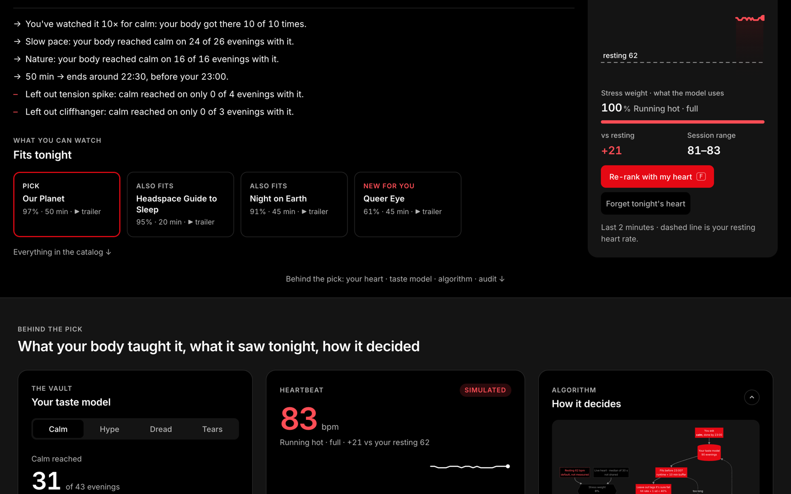

# NetFeel: Netflix 2046

*The paper behind the concept, written for the Design Future Course. Every fact was checked against the repo research and web search, then against the opened source pages.*

**Legend:** ✅ = verified against the source page · ⚠️ = still unconfirmed (only search results, or a blocked page) · *(added)* = not in the original draft, added after the research check · *(fixed)* = wording corrected after the fact check

---

## 0. Summary

**The brief:** *"Create a future speculation set in 2046 which outlines a plausible scenario of how media consumption habits, media production, and media creators have changed."*

**Our answer in one line:** in 2046 Netflix doesn't ask *what* you want to watch. It asks **how you want to feel.**

**NetFeel** is a Netflix service that learns how films and series make *your* body react, and recommends by feeling instead of by genre:

1. **Sense.** A wearable you already own (Apple Watch, Oura, Garmin) or one Netflix sells reads heart rate, HRV, skin temperature and movement while you watch.
2. **Learn.** NetFeel builds a personal mood profile: which content gives *you* excitement, calm, nostalgia or a good cry.
3. **Ask.** You search by feeling ("something that makes me feel brave"), in the app or through your personal AI assistant, which asks NetFeel on your behalf.
4. **Own.** The mood profile belongs to you: processed on the device, visible, deletable, never sold.

**The showcase:** **perspectives.** Selected films let you switch whose eyes you watch through, so the same story gives a different feeling and builds empathy.

**Why it matters for Netflix:** Netflix is financially strong, but attention is the limit. YouTube holds nearly twice Netflix's share of US TV time. Netflix can't win by out-uploading YouTube. It *can* win on something YouTube's ad-and-data model makes hard: **trust with your feelings.**

---

## 1. Current situation: Netflix in 2026

### 1.1 Strong, but growing more slowly than it wants
| Fact | Number | Source |
|---|---|---|
| Revenue 2025 | $45.18B (+15.9%), operating margin 29.5% ✅ | Netflix Q4 2025 / Q2 2026 shareholder letters |
| Growth *(updated)* | Q3 2026 revenue $12.87B, **+11.8%, the slowest growth in about three years**; 2026 guidance $51.1B (+13%); 2026 ad-revenue goal cut to ~$2.7B (from ~$3B); headcount reductions ✅ | Netflix Q3 2026 shareholder letter, 20 Oct 2026 |
| The CEO says it | Sarandos: *"Overall, we're not growing as fast as I want us to, and we're working on and making that move faster."* | Bloomberg Screentime, 1 Oct 2026 (via Barrett Media, Entrepreneur) ⚠️ |
| Viewing *(fixed)* | 97B+ hours in H1 2026, **up only 2% year over year** ✅ | Netflix "What We Watched" H1 2026, 16 Jul 2026 |
| Attention *(updated)* | US TV time, Aug 2026: **YouTube 15.8% vs Netflix 7.7%** ✅ (Sep/Oct not yet published) | Nielsen The Gauge, Aug 2026 (published 22 Oct 2026) |

**Conclusion:** money isn't the constraint. **Attention is.**

### 1.2 Company culture: how Netflix decides
- **No sacred cows.** Netflix rewrites its own rules once a cheap experiment proves the new one: *never ads* → an ad tier with ~250M monthly active viewers (May 2026) ✅; *binge only* → live events; *no theatrical* → event releases.
- **Test small, measure everything, scale loudly, kill quietly.** Netflix removed 20 of its 24 interactive specials by Dec 2024 and *Bandersnatch* itself in May 2025, saying the format had "served its purpose" ✅ *(fixed dates)*.
- **Culture is a product too:** *"We put no energy in preserving the culture. We are constantly working on improving the culture."* (Sarandos, WSJ Tech Live, Oct 2024; from the repo transcript). Underneath: candour, context not control, the keeper test.
- **The homepage *is* the experiment:** about 80% of hours streamed come from recommendations (Gomez-Uribe & Hunt, Netflix, 2015) ✅, with thousands of A/B tests running at once.

### 1.3 AI adoption today
- **Recommendations and artwork:** per-member artwork, now with post-trained LLMs (Netflix Research, 24 Feb 2026) ✅.
- **AI search:** Netflix tested OpenAI-powered search that understands moods ("something funny and sad") as an opt-in iOS beta in Australia and New Zealand (Apr 2025), then revealed more widely with the new TV experience (Netflix, 7 May 2025) ✅ *(fixed: a beta, not "shipped in 2024")*.
- **Production:** *El Eternauta* had the first GenAI final VFX shot in a Netflix original (said on the earnings call of 17 Jul 2025; reported 18 Jul 2025) ✅.

### 1.4 Why YouTube has more viewers
YouTube is **open**; Netflix is **curated**. That gives YouTube:
- **A creator economy.** The Partner Program gives creators 55% of ad revenue on long-form videos (45% on Shorts), from 1,000 subscribers and 4,000 watch hours ✅, so people build careers on it. Netflix pays producers up front for projects.
- **Relationships with people, not titles.** Comments, live chat and creator personalities. Deloitte 2026: **33%** of consumers feel a stronger personal connection to social media creators than to TV personalities or actors; in 2025 it was **roughly 50% of Gen Zs and millennials** ✅ *(fixed)*.
- **Something for every mood and moment:** tutorials, gaming streams, podcasts.
- **A free tier, and older viewers are coming.** Adults 65+ nearly doubled their YouTube TV viewing in two years (+96%) and make up 15.4% of it (Nielsen, Feb 2025) ✅. *(Fixed: no source says the free tier is the reason.)* Netflix's answer is its ad tier.
- **Learning and search:** about half of YouTube users say it's very important for learning how to do new things (Pew, 2018 ⚠️ dated).

**The opening for Netflix:** YouTube knows what you *clicked*. Netflix could know what you *felt*, and earn the trust to hold that.

**The client's three prompts** (from the project brief):
- **Microdramas** show people want short, intense feelings on demand (W16) → NetFeel picks by feeling, at any length.
- **Social media, user-generated content and AI** mean creators set the pace (W2, §1.4) → perspectives give creators a new format inside Netflix.
- **Broadcasters moving into streaming and partnering with social** → a trusted feeling layer is something Netflix could license to partners ⚠️ (no verified broadcaster evidence in the repo yet; say it as our view).

---

## 2. Trends and weak signals

Two levels, following the project's weak-signals method (signals that carry the concept vs. signals that merely enable it):
- **Trends** are already measurable and mainstream. They are the **infrastructure** that makes NetFeel possible.
- **Weak signals** are small, early and odd today. They **point** to the 2046 world.

### 2.1 Trends: the infrastructure that already exists
| # | Trend | Evidence | Source |
|---|---|---|---|
| T1 | **Wearables became continuous health monitors.** Sensors track heart rate, blood oxygen, skin temperature, ECG and movement outside clinics. With AI: early detection, remote care, large-scale health data; privacy and standards are still open | Research output on wearable health monitoring (yearly publication graph on the page; ⚠️ read the trend off the graph) | Nature Index topic page: wearable technology applications in health monitoring ✅ |
| T2 | **Screens fill young people's days.** A typical US teen spends **8 h 15 min** a day on screen media for entertainment, a tween **5 h** (medians). Short-form video has *"the single highest daily participation rate of any activity"*: 82% of teens, 58% of tweens ✅ *(fixed)* | US, 2026 | Common Sense Media Census 2026 |
| T3 *(added)* | **Machines already read stress** *(evidence added)*. Consumer wearables now sell "stress", not just steps: WHOOP Stress Monitor (29 Mar 2023), WHOOP 5.0 / MG (8 May 2025), Oura Cumulative Stress + AI advisor (20 Oct 2025) ✅ *(fixed date)*. Based on HRV against a personal baseline, so a **stress estimate, not a measured emotion** | 2023–2025 | Oura / WHOOP launches |
| T4 | **Focus on one screen keeps shrinking.** Gloria Mark measured how long people stay on one screen before switching: ~2.5 min (2003–04), ~75 s (2012), **~47 s on average from about 2016 onward** *(fixed: not "2024", and it's time-on-screen, not "attention span")* | 2004–2023 | Mark, G. (2023), *Attention Span* |
| T5 | **Discovery moved to social.** 52% of fans say social media is the main way they discover new content; **73% of Gen Z fans** ✅ | 2026 | Deloitte, 2026 Digital Media Trends (24 Mar 2026) |

### 2.2 Weak signals: all of them, ranked
**Tiers:** 🔴 **Key**: carries the argument · 🟠 **Support**: strengthens it · ⚪ **Background**: context only.
**Type:** *Weak* = early and fringe · *Emerging* = growing, not mainstream yet · *Trend* = already measurable and mainstream (kept as context).

#### 🔴 Key signals
| # | Signal | Evidence + source | Why a signal, not a trend | 2046 | Feeds |
|---|---|---|---|---|---|
| **W4** *(+W14)* | **Media that reacts to your heartbeat.** A horror game adapts its music and enemies to the player's heart rate in real time | Drexel master's thesis (Dahiya): 15 participants, engagement **6.00 vs 4.86** for the control group. Players *didn't notice* the changes (the control group rated the music as more adaptive), and the author calls for more transparency (2025 ⚠️ year from one reference list). Supporting: Bhagat et al., "Facial Emotion Recognition using CNN", *Procedia Computer Science* 235 (2024) ✅; the 65.68% accuracy figure ⚠️ couldn't be read on the page. Use it as a **limitation**: camera reading is still unreliable | One student project, 15 people: tiny, early, odd | Every story can listen to your body. NetFeel picks (and later shapes) content by how it actually lands on *you* | Feeling picks, transparency |
| **W8** | **Teens practise entering fiction ("reality shifting").** Self-hypnosis to "shift" into fictional worlds | 1.7B+ views of #realityshifting clips on one platform, a 40,000-member forum (peer-reviewed study, **2021** ✅ *(fixed date)*; USA Today, May 2024) | A niche internet subculture, not a behaviour most people share | Audiences want to *be inside* stories, not watch them from outside | **Perspectives** |
| **W6** | **Media used to reach a state.** Sleep content and the ASMR economy | **About 63% of ASMR viewers** use it to fall asleep ✅ *(fixed)* (HAUS ASMR report, Mar 2026, an industry source); 15% of Japan's YouTube audience watches ASMR weekly ⚠️ | People choose by *feeling*, not genre, but only inside one niche format so far | Netflix sells states ("calm by 23:00"), not hours | Feeling picks, emotion search |
| **W18** *(added, author's new signal)* | **Everyone gets a personal AI assistant, and it starts acting for you.** | ChatGPT reached ~800M **weekly** users by Apr 2025, the fastest consumer adoption ever (BOND/Meeker, May 2025) ✅. Assistants now **act**: ChatGPT Instant Checkout buys for you (29 Sep 2025, US) ✅; Google opened Google Home to third-party AI agents via MCP (16 Sep 2026) ✅ *(fixed date)* | Using chatbots is already a trend. The *weak* part is the assistant **acting on your behalf**: one assistant, one country, single items | You tell your assistant "I need to calm down"; it asks NetFeel; Netflix answers. The assistant becomes the remote | Emotion search via assistant, data ownership |
| **W10** | **Kids already hand their emotions to machines.** | **72% of US teens** have used AI companions, 33% for social or relationship reasons, and about a third of companion users discussed serious matters with AI instead of a person (Common Sense Media, Jul 2025) ✅ *(fixed)*; 64% of US teens use AI chatbots (Pew, 9 Dec 2025) ✅ *(data added)*; see also W11, W12 | Companions are new and contested, not yet a normal, trusted habit | 2046's 30-year-olds grew up sharing feelings with software: emotion-aware media feels normal, *if* it's trustworthy | Feeling picks, trust |

#### 🟠 Support signals
| # | Signal | Evidence + source | Type | 2046 | Feeds |
|---|---|---|---|---|---|
| W9 | **AI reorders discovery.** Netflix tested mood-based AI search (opt-in beta, spring 2025) *(fixed)* | Opt-in iOS beta, AU/NZ (Bloomberg, Apr 2025); wider reveal 7 May 2025 (Netflix) ✅; no wider rollout found in 2026 | Emerging (Netflix itself) | Asking replaces browsing; you converse your evening into existence | Emotion search |
| W2 | **AI slop floods the feeds.** >20% of videos shown to new YouTube users are AI slop; 278 slop channels hold 63B+ views, ~$117M/yr ✅ *(fixed: 278)*. AI slop is 57% of TikTok's Kids category (n=2,000 videos; Kapwing sells editing tools) ✅ *(fixed: cite Kapwing, not the blog)* | Kapwing via Guardian, 27 Dec 2025; Kapwing via Tubefilter, 16 Jun 2026 | Trend | "Verified human-made" becomes a trust badge and a luxury | Trust |
| W7 | **First under-16 social media ban becomes law.** Australia passed it 28 Nov 2024; fines up to A$49.5M; in force 10 Dec 2025. **But:** the ban barely bit (81.5% still use restricted services); the share of under-16s using messaging rose 40.5% → 52.3% and games 26.4% → 29% *(fixed: "pushes kids to play" isn't proven)* | BBC, Reuters 28 Nov 2024; eSafety data via Engadget, 31 Jul 2026 ✅ | Emerging (one country, spreading) | Age-verified, regulated media is the default; a trusted platform for young viewers wins | Trust, data ownership |
| W16 | **Microdramas.** Short serials made for phones | China: **696M** regular viewers (NRTA, as of Jul 2025) ✅ *(fixed: "half a billion" had no source)*; >1 in 10 internet users watch short scripted dramas of 10 minutes or less (Ampere) | Trend in China, weak in the West | Short, intense emotional hits on demand | Feeling picks |
| W15 | **Fans want content between releases.** 46% seek out fandom content from creators; the same 46% are more likely to engage with what their fan community recommends ✅ | Deloitte, 2026 Digital Media Trends | Trend data | Binge-and-done is a weak spot; fans want to stay in the world | Perspectives, shared viewing |
| W5 | **Kids watch a lot of other people's gameplay** ("rather watch than play"). Large consumption of Let's-Play video, driven by "peer pedagogy" communities | Scott et al., *Social Media + Society* (SAGE), Oct 2023 ✅; "peer pedagogies" is Dezuanni's term (MIT Press, 2020). *(Fixed: the paper documents viewing, not a measured preference)* | Emerging | Watching is participation: shows you can follow like sport, from someone else's view | Perspectives, shared viewing |
| W19 *(added)* | **EU limits emotion recognition.** The AI Act bans it at work and in schools (since 2 Feb 2025); elsewhere it's "high-risk" (Annex III), **not banned** | EU AI Act Art. 5(1)(f) ✅; Commission guidelines, 4 Feb 2025. The high-risk duties now apply from 2 Dec 2027 (AI Omnibus) ✅ | Emerging (law) | Outside work and school, emotion recognition is high-risk (strict duties), not banned. NetFeel is designed to meet those duties: consent, transparency, user control ⚠️ legal check | Data ownership, guardrails |
| W20 *(added)* | **A legal right to take your data with you.** The EU DMA forces big platforms to give continuous, real-time data portability | DMA Art. 6(9) ✅ | Emerging (gatekeepers only) | Your mood profile is yours and goes with you; any assistant can use it | Data ownership |

#### ⚪ Background signals
| # | Signal | Evidence + source | Type | 2046 |
|---|---|---|---|---|
| W1 | **Rewatching beats novelty ("comfort viewing").** Rewatching is routine; *The Office* and *Friends* top streaming charts *(fixed: "back-catalogue-dominated" wasn't Netflix's wording)* | Guardian 2019; Netflix "What We Watched" H1 2026 | Trend | Comfort shows become habitats you return to for a feeling |
| W3 | **TV becomes an activity on a second screen.** Gen Z and millennials split time about evenly across streaming, social video and gaming | Deloitte Digital Media Trends 2025 | Trend | The show is the environment; design the second screen as the first screen, where reactions are shared |
| W11 | **AI use starts early.** 36% of 9-year-olds, 55% of 11-year-olds and 73% of 13-year-olds have ever used AI chatbots ✅ | Common Sense Media Census 2026 | Trend |  AI is a normal childhood tool |
| W12 | **Used, but not loved.** Only 11% of teen and 15% of tween AI users enjoy it "a lot". Only 4% name ChatGPT as the one platform they couldn't live without; for YouTube it's 66% of tweens and 32% of teens ✅ *(fixed wording)* | Common Sense Media Census 2026 | Trend data | Trust and enjoyment, not usage, decide who wins |
| W13 | **Kids watch more than they post.** About 65% of 8–17s on social media mainly read, watch or like; ~34% post | Ofcom, Children's Online Experiences, May 2026 (via Advanced Television ⚠️; Ofcom PDF blocked) *(fixed: not the 2025 Children and Parents report)* | Trend | "Kids as creators" is true in games and AI, not on social feeds (our reading ⚠️) |
| W17 | **Fewer shared moments.** Deloitte's "signpost for the future": *"Hyper-personalization, enabled by AI, becomes so ubiquitous that there are fewer 'shared' cultural media moments."* A scenario, not survey data | Deloitte, 2026 Media & Entertainment Industry Outlook, 2 Mar 2026 ✅ | Emerging issue | Shared viewing becomes something you *choose* |
| W21 *(added)* | **AI drives data-centre power** (a *pressure*, not a weak signal). ~415 TWh in 2024 → ~945 TWh by 2030 | IEA, *Energy and AI*, Apr 2025 (via Scientific American, Down To Earth) ✅ | Trend | Sensing is cheap; generating content per person is not. Personal versions need a cost and carbon limit |

**The author's three insights from the research** (kept, used in sections 5 and 6):
- In a world of free, creator-led video, **"quality" is defined by how the viewer feels about the experience, not by budget** Deloitte: *"the 'quality' of content may be increasingly determined by how much audiences value their experience consuming it, not by how much was spent to produce it"* (2026 Media & Entertainment Industry Outlook) ✅.
- **Creator bonds are strong** → viewers choosing a creator's or character's perspective is plausible.
- **People choose music by feeling**, not by genre or BPM. NetFeel applies that to film.

### 2.3 Six-category overview *(added)*
| Category | Signals | What it tells us |
|---|---|---|
| **Social relationships** | W10 kids and AI emotions · W17 fewer shared moments | Feelings are already shared with machines; shared culture needs to be designed back in |
| **Individual behaviour** | W6 media for a state · W4 media reacting to the body | People pick by feeling; the body can be an input |
| **Politics & government** | W19 EU emotion-recognition limits · W20 DMA data portability · W7 under-16 ban | Regulation sets the rules: consent, user control, age checks |
| **Environment** | W21 AI data-centre power *(pressure)* | Per-person generation has an energy cost and needs a limit |
| **Economics** | W18 assistants that act and buy · W16 microdramas · W15 fan spending | The assistant becomes the shop window; short emotional formats make money |
| **Education & culture** | W8 reality shifting · W2 AI slop | Audiences want to inhabit stories, and want to know what's human-made |
| *Technology (cross-cutting driver)* | T1 wearables · T3 stress sensing · W9 AI search | The sensing and the asking already exist |

### 2.4 How the signals lead to the idea
```
Trends (infrastructure)        Key weak signals                 NetFeel
T1 wearables  ─┐
T3 stress     ─┼─▶ W4 media reacts to the heartbeat ─────▶ 1. SENSE + 2. LEARN  (feeling picks)
               │   W6 media used to reach a state   ─────▶ 3. ASK               (emotion search)
W9 AI search  ─┼─▶ W18 assistants act for you       ─────▶ 3. ASK via assistant
               │   W10 kids trust machines with feelings ▶ 4. OWN               (data ownership)
W19/W20 rules ─┘   W8 entering fiction              ─────▶ Showcase: perspectives
```

**Feedback loops (systems thinking):**
- **R1 (reinforcing):** more readings → better picks → more trust → more consent → more readings.
- **B1 (balancing):** comfort-only picks → fewer surprises and shared moments → members get bored → Netflix adds live and communal viewings.
- **B2 (balancing):** data misuse or scandal → regulation (AI Act, DMA) → limits on data → trust has to be re-earned.

---

## 3. The 2046 scenario: one evening with Noa

**Noa, 29, Amsterdam.** Was 9 in 2026, and grew up with YouTube, AI chatbots and the first social media bans. Wears a **Netflix ring** from the NetFeel bundle.

**19:40. Coming home.** It has been a long, bottled-up week. Noa hasn't let anything out. They don't open an app. They tell their assistant: *"I need a good cry tonight. Something that breaks my heart, and then lets me breathe."* The assistant asks NetFeel. Noa's mood profile stays on Noa's devices, and the assistant only gets the answer.

**19:42. The pick, with its reason.** The TV offers one film and one line: *"Because your breathing slowed and your pulse settled after the hardest scene in X: films that let you cry, then let you go."* Noa knows why it was picked, and that makes it feel like a service, not surveillance.

**19:45–21:40. The film.** The ring reads Noa's evening quietly. Halfway through, Noa cries, properly, for the first time all week. The film runs to its natural end, because for a good cry the ending *is* the feeling.

**21:40. The end.** No autoplay. NetFeel shows a small **feeling receipt**: *"Heartbroken, then lighter: yes. 7 of your last 10 evenings hit the feeling you asked for."* Noa deletes tonight's reading with one tap. They can: the data is theirs.

### What changed by 2046 (the brief's three angles)
| Angle | 2026 | 2046 |
|---|---|---|
| **How people watch** (consumption) | Browse rows, pick by genre, autoplay; ~47 s on one screen | Ask by feeling, often through an assistant; NetFeel picks for the state you want, then stops; perspectives let you re-enter a story; watching together means sharing reactions, not a room |
| **How content gets made** (production) | Test screenings, focus groups, A/B artwork | Directors set **emotion rails** (the feelings each scene should allow); an opt-in, aggregated, anonymous scene-level signal (no individual readings leave the device) shows **how scenes really land** (a "Body Panel" replacing focus groups); key films ship with **perspective tracks**; AI fills in versions inside the director's rails, and human-made scenes are labelled |
| **Who the creators are** (creators) | Studios and showrunners for Netflix; creators on YouTube | Directors become **feeling designers**; actors and creators record **perspectives**; creators earn per perspective watched; "verified human-made" is a mark of quality |

---

## 4. How Netflix stays up to date in this world

**The brief's own question.** Netflix stays up to date the way it always has: **it rewrites its own rules after an experiment proves the new one.** NetFeel is the next rule change: *engagement = hours* becomes *engagement = did you get the feeling you came for.*

### 4.1 Netflix culture, adapted to 2046
| Netflix culture today | In the NetFeel world |
|---|---|
| **No sacred cows** (ads, live, theatrical) | The new heresy: *"Netflix doesn't guess what you want to feel. It knows, because you tell it."* The old scoreboard, watch hours, retires |
| **Test small, measure, scale** | A 2028 pilot before any rollout (below) |
| **Context, not control** (for employees) | **Control for members:** every reading visible, skippable, deletable |
| **The keeper test** (for people) | A keeper test for **features**: a recommendation that doesn't hit the feeling is dropped, however much watch time it brings |
| **Candour** | **Transparent picks:** each recommendation says *why* ("because your pulse stayed high during X") |

### 4.2 The path from today to 2046
| When | Step | Evidence it's plausible |
|---|---|---|
| **2026** | Signals: stress-tracking wearables (T3), mood search beta (W9), assistants that act (W18), heart-rate-adaptive media (W4) | Section 2 |
| **2028** | **Pilot:** 12 weeks, A/B, bring-your-own wearable or phone camera, two lanes: *cozy/sleep* and *horror/thriller*. Metric: **State-Hit Rate**, the % of evenings where the body confirms the feeling you asked for | Netflix's own experiment pattern (ads, live) |
| **2030s** | Feeling search in every Netflix app; assistants call NetFeel; first perspective tracks on one franchise; the Netflix wearable bundle launches. *Barriers:* sensor accuracy, EU high-risk rules. *Owner:* Netflix | AI search + DMA-style portability |
| **2046** | NetFeel is how most members choose; perspectives are a standard storytelling format; State-Hit Rate replaces watch hours as the headline metric | The scenario in section 3 |

---

## 5. Our idea: NetFeel

### 5.1 What it is
A future Netflix that recommends films and series by **how you want to feel**, not by genre. Next to the normal subscription, **NetFeel** is a feeling service that works with a wearable: one you already own (Apple Watch, Oura, Garmin) or one bought through a Netflix bundle.

### 5.2 How it works
| Step | What happens | Example |
|---|---|---|
| **1. Sense** | While you watch, the wearable reads heart rate, HRV, skin temperature and movement. These give an estimate of stress and arousal *(fixed: an estimate, not a measured emotion)* | Pulse rises in the chase, settles in the ending |
| **2. Learn** | NetFeel builds your personal mood profile: which content creates which feeling **for you** | Horror gives *you* excitement and adrenaline → more films with a similar effect |
| **3. Ask** | Search by feeling: nostalgic, inspired, excited, heartbroken. In the app, or through your **personal AI assistant**, which asks NetFeel for you | "Make me feel inspired, 90 minutes max" |
| **4. Own** | The profile is processed on your device, stored as a mood profile only, visible, deletable, and never sold or used for ads | Delete tonight's reading with one tap |

**The music logic:** people pick songs by how they make them feel, not by genre, rhythm or BPM. NetFeel brings that to film and series.

### 5.3 Showcase: perspectives
Selected films let you **switch between characters' perspectives**. The director marks the doorways; the story stays the same, the feeling changes.
- **For viewers:** a new reason to rewatch (W1) and a way to be *inside* a story (W8).
- **For society:** **empathy**: you experience a situation through someone else's eyes.
- **For creators:** a new format to author, and a way to keep fans in the world between releases (W15).

### 5.4 Why it will work
1. **The tools exist.** Wearables already estimate stress (T1, T3). Body-reactive media raised engagement in a first test (W4).
2. **People already choose by feeling,** in music and in sleep content (W6).
3. **Asking replaces browsing.** Netflix tested mood search in 2025 (W9), and assistants are starting to act for people (W18).
4. **It plays to Netflix's strengths:** a curated catalogue, the best recommendation engine in streaming, and an experiment culture.
5. **It's hard for YouTube to copy.** A business built on ads and data struggles to promise *"your feelings are never sold."*

### 5.5 How NetFeel stands out (the author's three principles)
1. **Transparent picks.** The horror game study found players didn't notice invisible changes (W4). NetFeel always shows the reason ("because your pulse stayed high during X"), so it feels like a service, not surveillance.
2. **Shared culture, designed back in.** Personalisation can mean fewer shared moments (W17). NetFeel adds communal viewings where friends opt in to see each other's reactions, and live events everyone feels together.
3. **Feeling data owned by the viewer.** Processed on the device, only a mood profile kept, deletable. In the EU, regulators are already wary of emotion inference (W19), and portability rules point the same way (W20).

### 5.6 What already works today (MVP)
| Prototype | What it shows | Where |
|---|---|---|
| **Taste-model MCP demo** | A real Garmin heart rate → a taste model the member owns → Claude Desktop (a real AI assistant) asks it for a pick | [`prototypes/taste-model-mcp/`](../prototypes/taste-model-mcp/) |
| **Reaction Lab** | A laptop camera reads your reaction on the device → feeling receipt → recommendations by feeling | [`prototypes/reaction-lab/`](../prototypes/reaction-lab/) |



The paper presents the full 2046 world. The MVP is the part that already works in 2026.

---

## 6. Consequences: who wins, who loses

### 6.1 Impact matrix *(added)*
| | Social relationships | Individual behaviour | Politics & government | Environment | Economics | Education & culture |
|---|---|---|---|---|---|---|
| **Feeling picks** (sense + learn + ask) | Fewer arguments over what to watch; risk: less discovery of the unexpected | Evenings planned by feeling; risk: people avoid every uncomfortable feeling | Emotion data becomes a regulated category, like health data | More sensors and wearables → more e-waste | Wearable bundles; new metric (State-Hit Rate); feeling-based ads become a temptation | Media literacy has to include "how platforms read you" |
| **Perspectives** | Empathy across groups; shared talk ("whose side did you watch?") | Rewatching with purpose; more active viewing | Rights questions: who owns a character's perspective? | Extra versions → more compute and energy | New creator income per perspective; higher production cost | A new storytelling form taught in film schools |
| **Data ownership** (on-device, deletable, portable) | Trust between member and platform; opt-in sharing with friends | Control over your own data becomes a habit | Fits EU rules (AI Act, DMA); sets a standard others follow | On-device processing → less cloud compute | Trust as the selling point vs ad-funded rivals; less data to monetise | Trust in media rebuilt in the AI-slop era |

### 6.2 Who benefits, who is harmed
| Benefits | Harmed or at risk |
|---|---|
| Viewers who want the right content fast and stay in control | **People without wearables**, who get a worse Netflix: a new "sensor divide". *Answer: phone camera and plain feeling search work without one* |
| Creators and actors with a new format (perspectives) and real audience feedback | **Bodies the sensors read badly:** skin tone, heart conditions, neurodivergence can mean wrong readings |
| Netflix: a new metric, new trust, a reason to stay | **Young viewers**, if feeling data were ever used to keep them watching |
| Wearable makers, through partnerships | **Ad-funded rivals and data brokers** that can't make the same trust promise |
| | **Netflix itself, if the assistants (Google, OpenAI, Apple) become the gatekeepers of the remote:** the assistant decides which service answers "I need to calm down". Power also sits with wearable makers, who own the raw sensor data |

### 6.3 Second-order effects (what happens next)
- **If the rules slip:** feeling data becomes an ad-targeting goldmine; insurers or employers ask for "feeling receipts"; a black market in mood data.
- **Shared culture:** if everyone watches a different version, fewer big shared moments → Netflix answers with live, communal viewings.
- **Creators:** studios might write for "the feeling score" instead of the story. That's why the **director sets the rails**, and the data only shows how a scene lands.
- **Energy:** perspective versions generated per person are expensive. Generate only inside the director's rails, and behind a cost and carbon limit.

### 6.4 Guardrails (our ethics stance)
1. **The Skip button:** consent per moment; every reading can be skipped.
2. **Transparent:** every pick says why.
3. **Owned by the member:** on the device, deletable, portable, never sold, never used for ads. Only opt-in, aggregated scene-level signals ever reach creators.
4. **Never nudging:** Netflix never uses feelings to keep you watching. The session ends when you reach the feeling.
5. **Human rails:** directors set the emotional range; AI works inside it, and is labelled.

**The value we're betting on:** a person's feelings are theirs, and the platform has to earn the right to hold them. Choosing feeling over watch hours costs Netflix some ad-driven engagement, and that's deliberate.

---

## 7. The close

*"Netflix 2046 won't ask what you want to watch. It will ask how you want to feel, and then let you keep the answer."*

Every 2046 element above traces back to a 2026 trend or signal (section 2.4): plausible, not just provocative.

---

## Sources and open items

**Status after source checks.** Everything marked ✅ above was verified on the opened source page. These items are still open:

| Claim | Why still ⚠️ | How it's handled |
|---|---|---|
| Sarandos "not growing as fast as I want" | Bloomberg blocked; confirmed via Barrett Media and Entrepreneur | Fine to quote; cite Bloomberg Screentime, 1 Oct 2026 |
| T1 "research output keeps rising" | The graph data isn't in the page text | Look at the graph once, or say "a growing research field" |
| W4 thesis year (2025) | From one reference list only | Check the Drexel page in a browser |
| W14 65.68% / 7 emotions | ScienceDirect blocked scripts | Open the paper in a browser, or drop the number |
| W6 15% of Japan's YouTube audience | Search results only | Treated as unconfirmed |
| W13 Ofcom 65% / 34% | Ofcom PDF blocked; secondary sources only | Open the Ofcom report in a browser |
| W19 "legal" claims | Not a legal opinion | Say "high-risk, not banned", never "legal" |
| Pew 2018 "learning on YouTube" | Search results only, dated | Background only |

**Dropped:** "members grew faster than hours" (no source) and "the free tier explains older viewers" (no source).

Full verification was done against opened primary sources (audience reports, tech/policy texts, Netflix letters and Nielsen).

**Main sources:** Netflix shareholder letters incl. Q3 2026 (20 Oct 2026) and "What We Watched" (2025–26) · Nielsen The Gauge (2025–26) · Common Sense Media (2025, 2026) · Pew (2025) · Deloitte Digital Media Trends (2025, 2026) and 2026 M&E Industry Outlook · Ofcom (2026) · Kapwing via The Guardian and Tubefilter (2025, 2026) · Mark, G. (2023), *Attention Span* · Dahiya, Drexel University thesis · EU AI Act and DMA · IEA (2025) · BOND (2025). Full detail: [`research/sources/source-library.md`](../research/sources/source-library.md).
