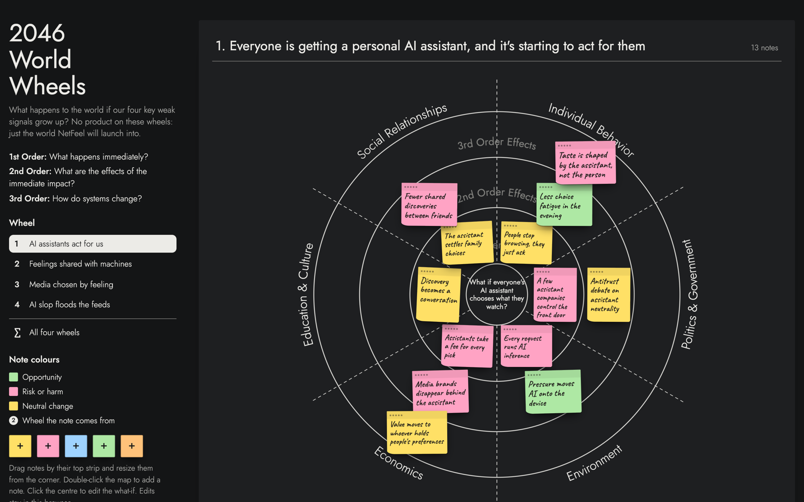
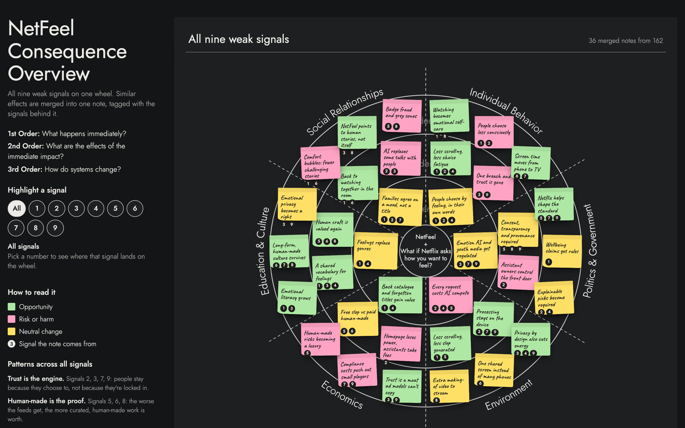

# Weak signals

Small things you can already see today that hint at how watching could work in 2046. Each signal has evidence and a source, and is mapped to what it could become.

| File | What it is |
|---|---|
| [`final-signals.md`](final-signals.md) | **The nine final signals**: what each is built from, what it means, and which NetFeel step it feeds. Also the enablers, the contrast signal and what was dropped. |
| [`signal-picklist.md`](signal-picklist.md) · [HTML](signal-picklist.html) | The same signals in plain words, grouped by category (individual behaviour, social relationships, economics, politics, education & culture, environment). |
| [`netfeel-world-wheels.html`](netfeel-world-wheels.html) | **2046 World Wheels**: the four key signals pushed forward on consequence wheels (1st, 2nd and 3rd-order effects across six areas). Interactive. |
| [`netfeel-consequence-overview.html`](netfeel-consequence-overview.html) | **Consequence Overview**: all nine signals on one wheel, with 162 notes merged into 36 and tagged by the signals behind them. Interactive. |

The full longlist (21 tiered signals, W1–W21, plus 5 enabling trends T1–T5) with every source is in §2 of the [scenario paper](../paper/netfeel-paper.md). The evidence behind each number is in [`../research/`](../research/).

## The wheels

Open the HTML files in any browser, no server needed. Pick a signal to highlight its notes, drag notes, or double-click to add your own; your edits stay in your browser.

| 2046 World Wheels | Consequence Overview |
|---|---|
|  |  |

**Note colours:** green = opportunity · pink = risk or harm · yellow = neutral change.
